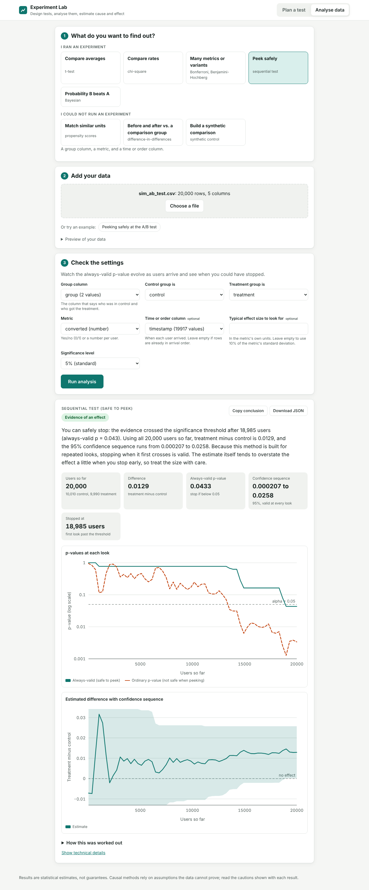
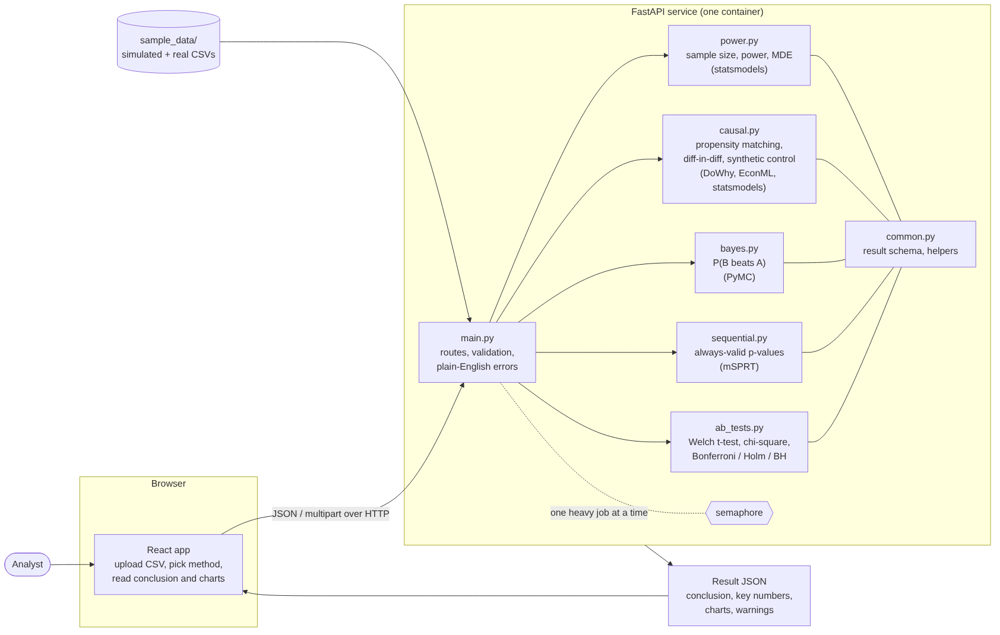

# Experiment Lab: an experimentation and causal inference platform

A web tool that helps a team **design** an A/B test, **analyse** it correctly, and **estimate cause and effect when an experiment is not possible**. You upload a CSV, pick a question, and get a plain-English conclusion with charts and the warnings a careful analyst would raise.

Built for assignment DS-04 (Data Science track). Stack: **FastAPI**, **statsmodels**, **PyMC**, **DoWhy**, **EconML**, **React**.



**Live demo:** _add the Hugging Face link here after deploying (see [docs/deployment.md](docs/deployment.md))_

## What it does

| Question | Method | Module |
|---|---|---|
| How many users do I need? What can I detect? | Power, sample size, minimum detectable effect | `expplat/power.py` |
| Did the average change? | Welch t-test, interval, effect size, sample-ratio check | `expplat/ab_tests.py` |
| Did the rate change? | Chi-square, Newcombe interval, Fisher exact for small counts | `expplat/ab_tests.py` |
| I tested many metrics or variants | Bonferroni, Holm, Benjamini-Hochberg | `expplat/ab_tests.py` |
| Can I peek at results while the test runs? | Sequential test with always-valid p-values (mSPRT) | `expplat/sequential.py` |
| What is the chance B beats A? | Bayesian analysis in PyMC with expected loss | `expplat/bayes.py` |
| No experiment: compare similar units | Propensity score matching, cross-checked with DoWhy and EconML | `expplat/causal.py` |
| No experiment: before and after vs. a comparison group | Difference-in-differences, pre-trend and placebo tests | `expplat/causal.py` |
| No experiment: one treated unit | Synthetic control with placebo inference | `expplat/causal.py` |

Every result has the same structure: a conclusion in plain English, key numbers, charts, and **warnings** (sample-ratio mismatch, broken parallel trends, poor overlap, a weak synthetic-control fit and so on).

## Results at a glance

All of these come from `python scripts/evaluate.py` (fixed seeds; tables in [docs/evaluation.md](docs/evaluation.md)), run on a Windows laptop (Intel i3, 8 GB memory, Python 3.10.6, PyMC 5.25.1 in its pure-Python mode because the machine has no C headers). With PyMC's compiled mode the Bayesian step takes about 1.6 s instead of 14.5 s, and a run of the same script on Linux with Python 3.13 gave the same results to within a few percent (LaLonde matching 1,627 instead of 1,722).

| Check | Result |
|---|---|
| t-test false-positive rate with no real effect (4,000 simulated experiments) | 4.9% (target 5%) |
| Power calculator vs simulation (394 per group, 0.2 sd effect, 80% target) | 79.1% |
| Power calculator vs simulation (14,745 per group, 10% to 11% conversion, 80% target) | 78.8% |
| 95% confidence-interval coverage | 95.6% |
| **Peeking** 10 times at an A/A test: ordinary p-value vs sequential test | **20.8% vs 0.9%** false alarms |
| Sequential test cost: power when the effect is real (single look 84.3%) | 52.5%, and it stops at a median of 2,523 of 4,000 users when it detects the effect |
| Multiple testing, 100 hypotheses, 20 real: chance of any false positive (none / Bonferroni / BH) | 98.5% / 4.8% / 41.0% |
| Multiple testing: false discovery rate (none / Bonferroni / BH) | 18.3% / 0.7% / 4.2% |
| PyMC vs exact Beta posterior for P(B beats A) | largest difference 0.0075 over 6 cases, R-hat at most 1.003 |
| LaLonde job training: randomised benchmark / naive / matching / DoWhy / EconML | 1,794 / -8,498 / **1,722** / **1,732** / 472 |
| Simulated confounded data (true effect 2.0): naive vs matching | 3.62 vs **2.04** |
| Difference-in-differences, simulated (true 3.0) | 3.01 on average |
| Synthetic control, simulated (true -4.0) | -4.00 on average |
| Time through the API (16,000-row matching with cross-checks / Bayesian / t-test) | 4.5 s / 14.5 s / 0.2 s |

Also worth knowing: fitting the Bayesian numeric model on sufficient statistics took 24 s against 184 s for the full-data model with the same answer (difference in means 1.807 vs 1.816). The same file lists the weaker results too: the sequential test gives up power in return for safe peeking, EconML's estimate on LaLonde is far from the benchmark, and on the Texas data the synthetic control does not fit well enough for a confident claim.

## Quick start

Requirements: Python 3.11 or newer and Node.js 18 or newer.

```bash
git clone https://github.com/GourabSaha66/experimentation-platform.git
cd experimentation-platform

python -m venv .venv
# Windows PowerShell:  .\.venv\Scripts\Activate.ps1      macOS/Linux:  source .venv/bin/activate
pip install -r requirements.txt

cd frontend && npm install && npm run build && cd ..
uvicorn expplat.main:app --port 8000
```

Open http://127.0.0.1:8000. Click a method, then one of the **examples** under "Add your data" to see it work without any setup. Interactive API docs are at http://127.0.0.1:8000/docs.

More detail (development mode, Docker, free public hosting): [docs/deployment.md](docs/deployment.md).

## Tests

```bash
python -m pytest -v                       # 52 tests: statistics, causal methods, API
python scripts/evaluate.py                # accuracy and speed numbers (about 6 minutes)
python scripts/evaluate.py --quick        # a fifth of the repetitions
python scripts/e2e_screenshots.py         # drives the real web app in a browser (needs: pip install playwright)
```

What the tests check, besides "it runs":

* **Calibration.** The t-test and chi-square reject a true null about 5% of the time, 95% intervals cover the truth about 95% of the time, and the power calculator's sample size gives roughly its promised power in simulation.
* **Known answers.** Matching removes the bias in confounded simulated data; difference-in-differences and synthetic control recover planted effects; the pre-trend test flags groups that drift apart.
* **Peeking.** Ordinary p-values checked ten times give about 20% false alarms; the sequential test stays under 5%.
* **PyMC against exact maths.** For yes/no metrics the Bayesian answer is compared with the closed-form Beta posterior.
* **Compiler fallback.** On a computer with a C++ compiler but no Python header files (a plain Windows install), PyMC's compiled sampler fails. The Bayesian module catches that, switches PyTensor to its pure-Python mode, and retries; tests simulate this with a deliberately broken compiler.
* **Regression test.** DoWhy's matching estimate used to drift between runs because its logistic regression did not converge on unscaled covariates (age next to earnings in dollars). The wrapper now standardises covariates, and a test checks that rescaling a column changes nothing.

## Project layout

```
expplat/            Python package (FastAPI app and all statistics)
  main.py             routes, validation, error messages
  power.py            sample size, power, MDE
  ab_tests.py         t-test, chi-square, multiple testing
  sequential.py       always-valid p-values
  bayes.py            PyMC models
  causal.py           matching, difference-in-differences, synthetic control
  simulate.py         seeded data simulators
  samples.py          built-in examples and the method catalogue
frontend/           React app (Vite); charts are drawn with plain SVG, no chart library
sample_data/        CSVs used by the examples (see docs/data_dictionary.md)
scripts/            make_sample_data.py, evaluate.py, e2e_screenshots.py
tests/              pytest suite
docs/               architecture, API reference, data dictionary, deployment, evaluation
deploy/             Hugging Face Space settings
Dockerfile          one image for API + React app
```



Documentation: [API reference](docs/api.md), [data dictionary](docs/data_dictionary.md), [deployment](docs/deployment.md), [evaluation tables](docs/evaluation.md).

## Design decisions

* **One response shape for every method** (`conclusion`, `key_numbers`, `charts`, `warnings`, `details`). Adding a method means writing one Python function; the front end needs no change because charts are described as data.
* **Warnings are part of the product.** A significance badge without the caveats is how experiments get misread. Each method checks its own assumptions and says when they look violated.
* **Honest inference for causal methods.** With one treated unit, clustered standard errors are unreliable, so difference-in-differences also reports a placebo-in-space p-value, and the text tells the user which to trust. Synthetic control reports the same kind of placebo test.
* **Sequential testing by always-valid p-values (mSPRT)** rather than group-sequential boundaries, so users can look at any time without planning the number of looks in advance. The price (less power than one look at a fixed size) is measured and shown above.
* **Bayesian numeric model on sufficient statistics.** The posterior is identical to using every row (checked in a test), but the run time does not grow with the number of rows.
* **No chart library.** Charts are small SVG components, so they work offline, follow light and dark mode, and the bundle stays about 57 kB compressed.
* **Heavy methods run one at a time** (a semaphore), so a small server cannot be overloaded by parallel sampling.

## Limitations

* The sequential test uses estimated variances, so its guarantee is asymptotic. It needs about 20 users per group before it starts and is not meant for tiny samples.
* The Bayesian numeric model assumes normally distributed values; for skewed metrics such as revenue, use the log transform option.
* Propensity matching only balances measured characteristics. The tool says so on every result, and no diagnostic can detect an unmeasured confounder.
* Synthetic control here uses the outcome history only (no extra predictor variables), and the bootstrap interval for matching is approximate.
* Difference-in-differences handles a single treatment date (two-period design), not staggered adoption.
* The Dockerfile has not been built in the environment where this was written (no Docker daemon was available). The same code runs locally with the steps above.
* Cookie Cats, Criteo/Hillstrom, IHDP, Card and Krueger and Proposition 99 data were not used (they need external downloads). The simulated A/B data, LaLonde, the organ-donation panel and the Texas panel fill the same roles.

## Data and credits

Real data sets come from the [`causaldata`](https://github.com/NickCH-K/causaldata) package by Nick Huntington-Klein (MIT licence), which bundles data from *Causal Inference: The Mixtape* and *The Effect*. LaLonde job-training data: LaLonde (1986) and Dehejia and Wahba (1999). Statistical methods: Johari et al. (2017) for the mixture sequential test; Abadie, Diamond and Hainmueller (2010) for synthetic control; Benjamini and Hochberg (1995) for false-discovery-rate control.